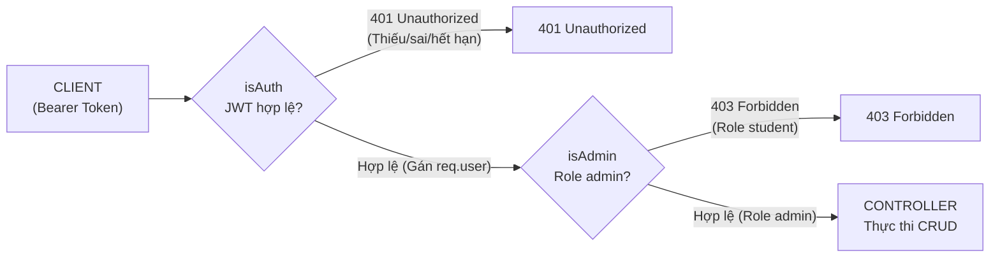

# GIÁO TRÌNH THỰC HÀNH · LẬP TRÌNH BACKEND
# CHƯƠNG 06: AUTHENTICATION & AUTHORIZATION
## JWT · MIDDLEWARE · PHÂN QUYỀN RBAC
### Bài thực hành Buổi 07 — Hệ Liên thông
**NỐI TIẾP PROJECT QUẢN LÝ SINH VIÊN TỪ CHƯƠNG 05**  
**Công nghệ:** Node.js · Express · TypeScript · pnpm · SQL Server · Sequelize  
**Mục tiêu:** Từ Register / Login đến bảo vệ API thực tế trong hệ thống học vụ  

---

> [!TIP]
> **TÀI LIỆU ĐỐI CHIẾU DỰ ÁN THỰC TẾ**:  
> Toàn bộ 21 trang của giáo trình PDF đã được số hóa sang Markdown tại file này, đồng thời tích hợp các khối **Đối chiếu dự án thực tế** để bạn dễ dàng tra cứu mã nguồn, script kiểm thử, ảnh chụp Playwright và tài liệu đã hoàn thành trong repository.

---

## MỤC LỤC
1. [01 · Đề bài, mục tiêu và điều kiện chuẩn bị](#01--đề-bài-mục-tiêu-và-điều-kiện-chuẩn-bị)
2. [02 · Phạm vi và API phải giữ đúng (Hợp đồng API)](#02--phạm-vi-và-api-phải-giữ-đúng)
3. [03 · Các file được bổ sung hoặc điều chỉnh (Bản đồ dự án)](#03--các-file-được-bổ-sung-hoặc-điều-chỉnh)
4. [04 · Khảo sát project trước khi yêu cầu AI code (Bước 0)](#04--khảo-sát-project-trước-khi-yêu-cầu-ai-code)
5. [05 · Thiết kế bảng tài khoản trong SQL Server (Bước 1)](#05--thiết-kế-bảng-tài-khoản-trong-sql-server)
6. [06 · Đăng ký tài khoản và băm mật khẩu (Bước 2 - Register)](#06--đăng-ký-tài-khoản-và-băm-mật-khẩu)
7. [07 · Xác thực mật khẩu và cấp Access Token (Bước 3 - Login)](#07--xác-thực-mật-khẩu-và-cấp-access-token)
8. [08 · Tạo và xác minh JWT đúng cấu hình (Bước 4 - JWT Utility)](#08--tạo-và-xác-minh-jwt-đúng-cấu-hình)
9. [09 · Viết Middleware isAuth (Bước 5 - Authentication)](#09--viết-middleware-isauth)
10. [10 · Viết isAdmin, kết hợp hai Middleware (Bước 6 - Authorization)](#10--viết-isadmin-kết-hợp-hai-middleware)
11. [11 · Bảo vệ các Route SinhVien đang có (Bước 7 - Ghép vào API)](#11--bảo-vệ-các-route-sinhvien-đang-có)
12. [12 · Chuẩn bị tài khoản kiểm thử phân quyền (Bước 8 - Seed Admin)](#12--chuẩn-bị-tài-khoản-kiểm-thử-phân-quyền)
13. [13 · Mô tả Bearer Auth trong OpenAPI 3.0 (Bước 9 - Swagger YAML)](#13--mô-tả-bearer-auth-trong-openapi-30)
14. [14 · Chuẩn bị Collection và token kiểm thử (Bước 10 - Postman)](#14--chuẩn-bị-collection-và-token-kiểm-thử)
15. [15 · Bảng test Register, Login và JWT (Nhóm A: A01 – A12)](#15--bảng-test-register-login-và-jwt-nhóm-a)
16. [16 · Bảng test isAuth và isAdmin trên SinhVien (Nhóm B: B01 – B12)](#16--bảng-test-isauth-và-isadmin-trên-sinhvien-nhóm-b)
17. [17 · Phát hiện lỗi từ code AI sinh ra (Bước 11 - Security Review)](#17--phát-hiện-lỗi-từ-code-ai-sinh-ra)
18. [18 · Khi AI viết code nhưng chương trình chưa chạy (Bước 12 - Xử lý lỗi)](#18--khi-ai-viết-code-nhưng-chương-trình-chưa-chạy)
19. [19 · Hồ sơ nộp và thang đánh giá (Rubric chấm 10 điểm)](#19--hồ-sơ-nộp-và-thang-đánh-giá)
20. [20 · Câu hỏi bảo vệ bài thực hành (Phần tự kiểm tra - 8 câu hỏi)](#20--câu-hỏi-bảo-vệ-bài-thực-hành)

---

## 01 · Đề bài, mục tiêu và điều kiện chuẩn bị

> **Định hướng**: Tiếp tục bài Chương 05 trên chính project đã có. Dùng AI hỗ trợ từng nhiệm vụ, nhưng sinh viên phải tự build, kiểm thử và giải thích kết quả.

### Đề bài thực hành
Hệ thống Quản lý sinh viên hiện có 5 API CRUD, Validation và Swagger, nhưng chưa có lớp bảo vệ theo tài khoản. Hãy nâng cấp hệ thống để người dùng đăng ký, đăng nhập nhận JWT; từ đó Backend nhận diện người gửi Request và chỉ cho Admin thêm, sửa, xóa sinh viên. Người dùng thường chỉ được xem các API công khai và hồ sơ của chính mình.
- **Đăng ký / đăng nhập**: Lưu User trong SQL Server bằng Sequelize, băm mật khẩu với bcrypt; login đúng cấp JWT hết hạn sau 1 giờ.
- **Bảo vệ API**: Viết `isAuth` xác minh Bearer Token và `isAdmin` kiểm tra role trước các Route `POST/PUT/DELETE` SinhVien.
- **Giữ hệ thống cũ**: `GET` danh sách/chi tiết vẫn public; giữ Zod/Validation, Logger, OpenAPI YAML và hợp đồng response đã học.

### Kết quả cần đạt sau bài thực hành
- **01.** Register hợp lệ trả `201`, trùng email `409`; SQL Server chỉ lưu `passwordHash`, không lưu mật khẩu gốc.
- **02.** Login đúng trả `200 + accessToken`; login sai trả `401`; gọi `/api/auth/profile` chỉ thành công khi JWT hợp lệ.
- **03.** Thao tác ghi không có JWT bị chặn `401`, tài khoản student bị chặn `403`; Admin thao tác CRUD thành công và dữ liệu thay đổi đúng.
- **04.** Project `pnpm build` thành công, có Swagger Bearer Auth, Postman Collection, kết quả 24 ca test và nhật ký prompt/review.

### Đầu vào bắt buộc
| Thành phần | Điều phải có trước khi bắt đầu |
|---|---|
| **Dự án gốc** | `backend-quan-ly-sinh-vien`; 5 API CRUD, Middleware Logger/Validation và file OpenAPI YAML từ Chương 05. |
| **Môi trường** | Node.js, pnpm, VS Code; có Postman hoặc Swagger UI để kiểm thử. |
| **Nguồn dữ liệu** | Có SQL Server + Sequelize hoạt động. Không dùng mảng RAM. |
| **An toàn** | Sao lưu/commit code cũ; chỉ dùng tài khoản và bản ghi thực hành. |

> **Quy trình mỗi bước**: Đọc yêu cầu $\rightarrow$ gửi một prompt $\rightarrow$ đối chiếu các file thay đổi $\rightarrow$ `pnpm build` $\rightarrow$ kiểm thử API thật $\rightarrow$ lưu bằng chứng. Không coi code AI trả về là kết quả đã đạt.

> [!NOTE]
> **Đối chiếu dự án thực tế**:
> - Đã tạo file quy trình chuẩn: [`docs/quy_trinh_lam_viec.md`](file:///d:/BACKEND-20261001-DANGBACNAM/docs/quy_trinh_lam_viec.md).
> - Đã tạo file theo dõi từng module: [`docs/tien_do.md`](file:///d:/BACKEND-20261001-DANGBACNAM/docs/tien_do.md).

---

## 02 · Phạm vi và API phải giữ đúng

> Không xây lại project, không chuyển sang ví dụ Products/Courses và không thay đổi cách lưu bảng SinhVien đang hoạt động.

| Nhóm | Method & endpoint | Quy tắc sau buổi 07 |
|---|---|---|
| **Auth** | `POST /api/auth/register` | Public; hợp lệ trả `201 Created`, email trùng trả `409 Conflict`. |
| **Auth** | `POST /api/auth/login` | Public; đúng trả `200 OK + accessToken`, sai trả `401 Unauthorized`. |
| **Auth** | `GET /api/auth/profile` | Yêu cầu `isAuth`; JWT hợp lệ mới trả `200 OK`. |
| **SinhVien** | `GET /api/v1/sinh-vien`<br>`GET /api/v1/sinh-vien/:maSV` | Giữ **Public** và hợp đồng dữ liệu của Chương 04–05. |
| **SinhVien** | `POST /api/v1/sinh-vien`<br>`PUT /api/v1/sinh-vien/:maSV`<br>`DELETE /api/v1/sinh-vien/:maSV` | Gắn `isAuth` $\rightarrow$ `isAdmin` trước logic cũ; Admin hợp lệ giữ mã `201/200/200`. |

### Hai lớp kiểm soát bắt buộc


> **Nguyên tắc phân biệt**:
> - `401 Unauthorized`: Chưa xác thực hợp lệ (thiếu / sai / hết hạn JWT).
> - `403 Forbidden`: Đã xác thực nhưng không đủ vai trò (role không phải admin).
> - **Bắt buộc đặt `isAuth` trước `isAdmin`**.

> [!NOTE]
> **Đối chiếu dự án thực tế**:
> - Middleware `isAuth`: [`src/middlewares/isAuth.ts`](file:///d:/BACKEND-20261001-DANGBACNAM/src/middlewares/isAuth.ts)
> - Middleware `isAdmin`: [`src/middlewares/isAdmin.ts`](file:///d:/BACKEND-20261001-DANGBACNAM/src/middlewares/isAdmin.ts)
> - Gắn vào Route SinhVien: [`src/routes/sinhVien.routes.ts`](file:///d:/BACKEND-20261001-DANGBACNAM/src/routes/sinhVien.routes.ts)

---

## 03 · Các file được bổ sung hoặc điều chỉnh

### Cấu trúc tham chiếu dự án
```text
backend-quan-ly-sinh-vien/
|-- package.json              # Thêm bcrypt, jsonwebtoken, @types
|-- .env / .env.example       # JWT_SECRET; KHÔNG commit file .env
|-- sql/04-users-auth.sql     # Tạo bảng Users, không DROP
|-- src/
|   |-- server.ts             # Gắn auth router một lần, static client
|   |-- models/user.model.ts  # Sequelize Model User (dbo.Users)
|   |-- services/auth.service.ts
|   |-- controllers/auth.controller.ts
|   |-- routes/auth.routes.ts
|   |-- utils/jwt.ts          # generateToken (HS256 1h), verifyToken
|   |-- middlewares/isAuth.ts # Kiểm tra Bearer token (401)
|   |-- middlewares/isAdmin.ts# Kiểm tra req.user.role === 'admin' (403)
|   |-- types/express.d.ts    # Khai báo mở rộng req.user { id, role }
|   `-- scripts/seed-admin.ts # Khởi tạo Admin an toàn trên máy dev
|-- docs/openapi.yaml         # Cập nhật Bearer Auth, Auth tags, 401/403
|-- docs/prompt-log.md        # Ghi nhật ký prompt và trả lời 8 câu hỏi
|-- docs/test-results.md      # Ma trận 24 ca test thực tế A01–B12
`-- postman/                  # Postman Collection JSON 24 ca test
```

> **Lưu ý cốt lõi**:
> - Giữ nguyên router SinhVien, Controller, Service, Model, DTO và Validation đã làm; chỉ ghép Middleware vào các Route cần bảo vệ.
> - Dự án TypeScript ESM/NodeNext import nội bộ bằng đuôi `.js`.
> - Mọi thêm/sửa trên database phải qua script SQL được kiểm tra trước; không dùng `sync({ force: true })`, `sync({ alter: true })`.
> - **Quan trọng**: `User` dùng để xác thực tài khoản, không phải bảng `SinhVien` cũ. Tuyệt đối không thêm `role`, `password` vào DTO `SinhVien`.

---

## 04 · Khảo sát project trước khi yêu cầu AI code (Bước 0)

### Lệnh kiểm tra nền tảng
```bash
node -v
pnpm -v
pnpm install
pnpm build
pnpm dev
```
1. Gọi `GET /api/v1/sinh-vien` $\rightarrow$ `200 OK`.
2. Xác định SQL Server đang kết nối qua Sequelize, tên table `SinhVien` và cấu trúc `AppError`/response hiện có.
3. Commit hoặc sao lưu trạng thái chạy đúng; ghi lại PORT, các Middleware đã gắn và vị trí mount router.

### Prompt 0 mẫu (Khảo sát, chưa viết code)
```text
C: Tôi tiếp tục project quản lý sinh viên sau Chương 05, dùng Express, TypeScript, pnpm, SQL Server + Sequelize; có docs/openapi.yaml.
T: Đọc các file tôi cung cấp; mô tả luồng Request hiện tại, cách DB kết nối và các vị trí nên thêm register/login, JWT Middleware.
C: Chưa sửa hay tạo file, không tạo project mới, không đoán nội dung file thiếu, không yêu cầu mật khẩu hoặc toàn bộ .env.
O: Trả bảng "file / đang làm gì / cần giữ hay sửa / lý do" và danh sách thông tin còn thiếu trước khi triển khai.
```

> [!NOTE]
> **Đối chiếu dự án thực tế**:
> - Đã tạo giao diện kiểm thử trực quan tại `http://localhost:5000/client` ([`public/index.html`](file:///d:/BACKEND-20261001-DANGBACNAM/public/index.html), [`public/app.js`](file:///d:/BACKEND-20261001-DANGBACNAM/public/app.js)).
> - Ảnh minh chứng Module 0: [`docs/screenshots/module-0-client.png`](file:///d:/BACKEND-20261001-DANGBACNAM/docs/screenshots/module-0-client.png).

---

## 05 · Thiết kế bảng tài khoản trong SQL Server (Bước 1)

> Tài khoản đăng nhập tách khỏi dữ liệu học vụ. Sinh viên tự đăng ký chỉ có vai trò `student`; không được truyền `role` từ Request để tạo Admin.

### Cấu trúc bảng `dbo.Users`
| Cột User | Kiểu dữ liệu | Ràng buộc |
|---|---|---|
| `id` | `INT IDENTITY(1,1)` | Khóa chính (PK), tự tăng. |
| `fullName` | `NVARCHAR(150)` | Bắt buộc (`NOT NULL`), không rỗng. |
| `email` | `NVARCHAR(254)` | Bắt buộc, `UNIQUE`, chuẩn hóa chữ thường. |
| `passwordHash` | `NVARCHAR(255)` | Lưu mã băm bcrypt; tuyệt đối không lưu plaintext. |
| `role` | `NVARCHAR(20)` | Mặc định `'student'`; chỉ chấp nhận `'student'` hoặc `'admin'`. |

### Quy tắc triển khai
- Viết script SQL an toàn (`IF NOT EXISTS`), không DROP bảng.
- Model Sequelize cấu hình `timestamps: false` vì bảng không có cột `createdAt`/`updatedAt`.
- Cấp quyền tối thiểu `SELECT, INSERT, UPDATE, DELETE` cho tài khoản ứng dụng `sv_app`.

> [!NOTE]
> **Đối chiếu dự án thực tế**:
> - Script SQL: [`sql/04-users-auth.sql`](file:///d:/BACKEND-20261001-DANGBACNAM/sql/04-users-auth.sql).
> - Sequelize Model: [`src/models/user.model.ts`](file:///d:/BACKEND-20261001-DANGBACNAM/src/models/user.model.ts) và export tại [`src/models/index.ts`](file:///d:/BACKEND-20261001-DANGBACNAM/src/models/index.ts).

---

## 06 · Đăng ký tài khoản và băm mật khẩu (Bước 2 - Register)

### Request mẫu
```http
POST {{baseUrl}}/api/auth/register
Content-Type: application/json

{
  "fullName": "Nguyen Minh An",
  "email": "an.lab@example.com",
  "password": "SinhVien@123"
}
```

### Quy tắc nghiệp vụ
1. Dữ liệu lỗi định dạng hoặc thiếu trường: trả `400 Bad Request`.
2. Email đã tồn tại trong CSDL: trả `409 Conflict`.
3. Service gọi `bcrypt.hash(password, 12)` và chỉ ghi `passwordHash` vào SQL Server.
4. Không nhận `role` từ body; từ chối khi client truyền `role` (Ca A03). Backend gán cứng role `'student'`.
5. Đăng ký thành công: trả `201 Created` kèm thông tin User công khai; **tuyệt đối không trả `password`/`passwordHash`**.

> [!NOTE]
> **Đối chiếu dự án thực tế**:
> - Hàm `registerUser`: [`src/services/auth.service.ts`](file:///d:/BACKEND-20261001-DANGBACNAM/src/services/auth.service.ts).
> - Controller `register`: [`src/controllers/auth.controller.ts`](file:///d:/BACKEND-20261001-DANGBACNAM/src/controllers/auth.controller.ts).
> - Tuyến đường: [`src/routes/auth.routes.ts`](file:///d:/BACKEND-20261001-DANGBACNAM/src/routes/auth.routes.ts).
> - Ảnh minh chứng Module 3: [`docs/screenshots/module-3-register.png`](file:///d:/BACKEND-20261001-DANGBACNAM/docs/screenshots/module-3-register.png).

---

## 07 · Xác thực mật khẩu và cấp Access Token (Bước 3 - Login)

### Request / Response mẫu
```http
POST {{baseUrl}}/api/auth/login
Content-Type: application/json

{
  "email": "an.lab@example.com",
  "password": "SinhVien@123"
}
```

Response thành công (`200 OK`):
```json
{
  "success": true,
  "message": "Đăng nhập thành công",
  "data": {
    "accessToken": "eyJhbGciOiJIUzI1NiIsIn...",
    "tokenType": "Bearer",
    "expiresIn": 3600
  }
}
```

### Quy tắc an ninh
- Email không tồn tại hoặc mật khẩu sai đều trả chung mã **`401 Unauthorized`** kèm thông điệp `"Email hoặc mật khẩu không chính xác"`, ngăn chặn tấn công dò quét email (Email Enumeration).
- Không viết `user.passwordHash === password`. Phải dùng `await bcrypt.compare(password, user.passwordHash)`.
- Tuyệt đối không log password hoặc Token vào console/Morgan logger.
- Payload JWT chứa `sub` (id User dạng chuỗi) và `role`; thời hạn 1 giờ (`3600s`).

> [!NOTE]
> **Đối chiếu dự án thực tế**:
> - Hàm `loginUser`: [`src/services/auth.service.ts`](file:///d:/BACKEND-20261001-DANGBACNAM/src/services/auth.service.ts).
> - Controller `login`: [`src/controllers/auth.controller.ts`](file:///d:/BACKEND-20261001-DANGBACNAM/src/controllers/auth.controller.ts).
> - Ảnh minh chứng Module 4: [`docs/screenshots/module-4-login.png`](file:///d:/BACKEND-20261001-DANGBACNAM/docs/screenshots/module-4-login.png).

---

## 08 · Tạo và xác minh JWT đúng cấu hình (Bước 4 - JWT Utility)

### Cấu hình chuẩn module `src/utils/jwt.ts`
```typescript
jwt.sign(
  { sub: String(user.id), role: user.role },
  JWT_SECRET,
  { expiresIn: '1h', algorithm: 'HS256' }
);

jwt.verify(token, JWT_SECRET, {
  algorithms: ['HS256']
});
```

### Yêu cầu kỹ thuật
- `JWT_SECRET` bắt buộc lấy từ biến môi trường `process.env.JWT_SECRET`; ứng dụng phải báo lỗi nếu secret rỗng.
- Khóa bí mật không được commit lên git (đã cấu hình trong `.gitignore`).
- Thuật toán xác minh bắt buộc là `HS256`. Không tin tưởng `jwt.decode` để xác thực quyền.
- Token hợp lệ gồm đúng 3 phần phân tách bởi dấu chấm (`Header.Payload.Signature`).

> [!NOTE]
> **Đối chiếu dự án thực tế**:
> - Module JWT: [`src/utils/jwt.ts`](file:///d:/BACKEND-20261001-DANGBACNAM/src/utils/jwt.ts).
> - File cấu hình mẫu: [`.env.example`](file:///d:/BACKEND-20261001-DANGBACNAM/.env.example).

---

## 09 · Viết Middleware isAuth (Bước 5 - Authentication)

Trạm kiểm soát danh tính chung: Nhận header `Authorization: Bearer <token>`, xác minh JWT, gán thông tin vào `req.user`.

| Tình huống | Kết quả bắt buộc |
|---|---|
| Không có `Authorization`, thiếu `Bearer `, token rỗng | `401 Unauthorized`; Controller không chạy. |
| Token bị sửa, sai chữ ký số hoặc đã hết hạn | `401 Unauthorized`; Controller không chạy. |
| Token hợp lệ, claims có `sub` và `role` | Gán `req.user = { id: payload.sub, role: payload.role }` rồi gọi `next()`. |

> **Khai báo TypeScript rõ ràng**: Sử dụng file khai báo `src/types/express.d.ts` để mở rộng kiểu cho `Express.Request` có `req.user`, tránh ép kiểu `as any`.

> [!NOTE]
> **Đối chiếu dự án thực tế**:
> - Type Definition: [`src/types/express.d.ts`](file:///d:/BACKEND-20261001-DANGBACNAM/src/types/express.d.ts).
> - Middleware: [`src/middlewares/isAuth.ts`](file:///d:/BACKEND-20261001-DANGBACNAM/src/middlewares/isAuth.ts).
> - API Profile: `GET /api/auth/profile` trong [`src/controllers/auth.controller.ts`](file:///d:/BACKEND-20261001-DANGBACNAM/src/controllers/auth.controller.ts).
> - Ảnh minh chứng Module 5: [`docs/screenshots/module-5-profile.png`](file:///d:/BACKEND-20261001-DANGBACNAM/docs/screenshots/module-5-profile.png).

---

## 10 · Viết isAdmin, kết hợp hai Middleware (Bước 6 - Authorization)

`isAuth` xác nhận danh tính người dùng; `isAdmin` quyết định người đã xác thực có được thực hiện thao tác quản trị hay không. Đây là hai trách nhiệm tách biệt:

```typescript
// Thứ tự đặt middleware bắt buộc
router.delete('/:maSV', isAuth, isAdmin, xoaSinhVien);
```

### Bảng phân quyền
| Người gọi | `isAuth` | `isAdmin` | Kết quả |
|---|---|---|---|
| Không có JWT | Từ chối | Không chạy | **401 Unauthorized** |
| `student`, JWT hợp lệ | Cho qua | Từ chối | **403 Forbidden** |
| `admin`, JWT hợp lệ | Cho qua | Cho qua | **Vào Controller** (200/201) |

> **Lưu ý**: Không nhận role từ `req.body` hay `req.query`. Nếu thiếu `req.user`, phải xử lý an toàn, không để gây lỗi sập server 500.

> [!NOTE]
> **Đối chiếu dự án thực tế**:
> - Middleware `isAdmin`: [`src/middlewares/isAdmin.ts`](file:///d:/BACKEND-20261001-DANGBACNAM/src/middlewares/isAdmin.ts).

---

## 11 · Bảo vệ các Route SinhVien đang có (Bước 7 - Ghép vào API)

Gắn chuỗi middleware vào các thao tác ghi dữ liệu của SinhVien trong [`src/routes/sinhVien.routes.ts`](file:///d:/BACKEND-20261001-DANGBACNAM/src/routes/sinhVien.routes.ts):

```typescript
// 1. Tuyến đường Public
router.get('/', getDanhSachSinhVien);
router.get('/:maSV', getSinhVienTheoMa);

// 2. Tuyến đường bảo vệ (Admin Only)
router.post('/', isAuth, isAdmin, taoSinhVien);
router.put('/:maSV', isAuth, isAdmin, capNhatSinhVien);
router.delete('/:maSV', isAuth, isAdmin, xoaSinhVien);
```

> **Nguyên tắc**: Không sửa response thành công của Admin (`201` khi tạo, `200` khi sửa/xóa); không làm hồi quy logic CRUD đã xây dựng ở Chương 04–05.

> [!NOTE]
> **Đối chiếu dự án thực tế**:
> - File routes: [`src/routes/sinhVien.routes.ts`](file:///d:/BACKEND-20261001-DANGBACNAM/src/routes/sinhVien.routes.ts).
> - Ảnh minh chứng sinh viên bị chặn 403: [`docs/screenshots/module-6-rbac.png`](file:///d:/BACKEND-20261001-DANGBACNAM/docs/screenshots/module-6-rbac.png).

---

## 12 · Chuẩn bị tài khoản kiểm thử phân quyền (Bước 8 - Seed Admin)

Để kiểm thử `403` và luồng thành công của Admin, cần 2 tài khoản:
1. **`student-test`**: Tự đăng ký công khai qua API `POST /api/auth/register` $\rightarrow$ role `student`.
2. **`admin-test`**: Tạo từ quy trình nội bộ bằng script `src/scripts/seed-admin.ts` $\rightarrow$ role `admin`.

### Script Seed Admin (`pnpm run seed:admin`)
- Tài khoản mặc định: `admin@example.com` / `Admin@123`.
- Băm mật khẩu bằng `bcrypt.hash(password, 12)`.
- Idempotent: Nếu tài khoản đã tồn tại thì đồng bộ role `'admin'` và mật khẩu mới; nếu chưa thì tạo mới.
- Tuyệt đối không mở API công khai cấp quyền Admin (tránh lỗ hổng leo quyền).

> [!NOTE]
> **Đối chiếu dự án thực tế**:
> - Script: [`src/scripts/seed-admin.ts`](file:///d:/BACKEND-20261001-DANGBACNAM/src/scripts/seed-admin.ts).
> - Lệnh chạy: `"seed:admin": "tsx src/scripts/seed-admin.ts"` trong [`package.json`](file:///d:/BACKEND-20261001-DANGBACNAM/package.json).
> - Ảnh minh chứng Admin thêm sinh viên thành công: [`docs/screenshots/module-7-seed-admin.png`](file:///d:/BACKEND-20261001-DANGBACNAM/docs/screenshots/module-7-seed-admin.png).

---

## 13 · Mô tả Bearer Auth trong OpenAPI 3.0 (Bước 9 - Swagger YAML)

Tái sử dụng [`docs/openapi.yaml`](file:///d:/BACKEND-20261001-DANGBACNAM/docs/openapi.yaml), bổ sung định nghĩa bảo mật và các endpoint mới:

```yaml
components:
  securitySchemes:
    bearerAuth:
      type: http
      scheme: bearer
      bearerFormat: JWT

# Gắn bảo vệ cho GET profile và POST/PUT/DELETE sinh viên
security:
  - bearerAuth: []
```
- Khai báo đầy đủ 3 API xác thực: `POST /api/auth/register`, `POST /api/auth/login`, `GET /api/auth/profile`.
- Mô tả các phản hồi `401 Unauthorized` và `403 Forbidden`.
- Giao diện Swagger UI tại `http://localhost:5000/api-docs` hiển thị nút **Authorize 🔓** để nhập Bearer Token.

> [!NOTE]
> **Đối chiếu dự án thực tế**:
> - Tài liệu OpenAPI: [`docs/openapi.yaml`](file:///d:/BACKEND-20261001-DANGBACNAM/docs/openapi.yaml).
> - Cấu hình nạp: [`src/config/swagger.config.ts`](file:///d:/BACKEND-20261001-DANGBACNAM/src/config/swagger.config.ts).
> - Ảnh minh chứng Swagger UI: [`docs/screenshots/module-8-swagger.png`](file:///d:/BACKEND-20261001-DANGBACNAM/docs/screenshots/module-8-swagger.png).

---

## 14 · Chuẩn bị Collection và token kiểm thử (Bước 10 - Postman)

### Biến môi trường Postman
| Biến | Giá trị minh họa | Lưu ý an toàn |
|---|---|---|
| `baseUrl` | `http://localhost:5000` | Đúng cổng server đang chạy. |
| `studentToken` | Lấy từ `POST /api/auth/login` bằng tài khoản student | Tự động lưu bằng test script, không commit token thật. |
| `adminToken` | Lấy từ `POST /api/auth/login` bằng tài khoản admin | Tự động lưu bằng test script, không commit token thật. |
| `testMaSV` | `SV088` | Đúng định dạng `SV` kèm 3 chữ số (`^SV[0-9]{3}$`). |

> [!NOTE]
> **Đối chiếu dự án thực tế**:
> - File Collection: [`postman/Chuong06-Auth-RBAC.postman_collection.json`](file:///d:/BACKEND-20261001-DANGBACNAM/postman/Chuong06-Auth-RBAC.postman_collection.json).
> - Script sinh tự động: [`src/scripts/generate-postman.ts`](file:///d:/BACKEND-20261001-DANGBACNAM/src/scripts/generate-postman.ts).

---

## 15 · Bảng test Register, Login và JWT (Nhóm A)

| Mã | Request / Tình huống | Mong đợi | Bằng chứng kiểm chứng | Trạng thái thực tế |
|:---:|---|:---:|---|:---:|
| **A01** | Register email mới, body hợp lệ | **201** | User tồn tại; role=student; không lộ passwordHash | ✅ **ĐẠT** |
| **A02** | Register trùng email A01 | **409** | Không tăng số User; thông báo "Email đã được sử dụng" | ✅ **ĐẠT** |
| **A03** | Register body thêm role=admin | **400** | Không tạo tài khoản Admin; chặn chỉ định role | ✅ **ĐẠT** |
| **A04** | Register thiếu password / email sai | **400** | Validation bắt lỗi, không lưu dữ liệu lỗi | ✅ **ĐẠT** |
| **A05** | Login đúng tài khoản student | **200** | `data.accessToken` hợp lệ, cấp JWT 1 giờ | ✅ **ĐẠT** |
| **A06** | Login sai password | **401** | Thông báo chung "Email hoặc mật khẩu không chính xác" | ✅ **ĐẠT** |
| **A07** | Login email không tồn tại | **401** | Không lộ thông tin tồn tại User (cùng lỗi 401 như A06) | ✅ **ĐẠT** |
| **A08** | GET `/api/auth/profile` không có token | **401** | Không nhận data hồ sơ; báo thiếu Bearer token | ✅ **ĐẠT** |
| **A09** | Profile với token bị sửa 1 ký tự | **401** | Chữ ký không qua xác minh (`JsonWebTokenError`) | ✅ **ĐẠT** |
| **A10** | Profile với JWT student hợp lệ | **200** | Hồ sơ đúng user, không chứa passwordHash | ✅ **ĐẠT** |
| **A11** | Token hết hạn gọi Profile | **401** | Báo lỗi token đã hết hạn (`TokenExpiredError`) | ✅ **ĐẠT** |
| **A12** | Register/login và xem SQL Server | **PASS** | `passwordHash` bắt đầu bằng `$2b$12$`, không lưu mật khẩu rõ | ✅ **ĐẠT** |

---

## 16 · Bảng test isAuth và isAdmin trên SinhVien (Nhóm B)

| Mã | Request / Tài khoản | Mong đợi | Kiểm chứng thêm bằng GET / SELECT | Trạng thái thực tế |
|:---:|---|:---:|---|:---:|
| **B01** | GET danh sách, không JWT | **200** | `data` vẫn là mảng, truy cập công khai | ✅ **ĐẠT** |
| **B02** | POST SinhVien, không JWT | **401** | Không INSERT bản ghi mới vào CSDL | ✅ **ĐẠT** |
| **B03** | PUT SinhVien, token không hợp lệ | **401** | Giá trị cũ trong database không đổi | ✅ **ĐẠT** |
| **B04** | DELETE SinhVien, JWT student | **403** | Sinh viên vẫn tồn tại trong CSDL | ✅ **ĐẠT** |
| **B05** | POST SinhVien, JWT student | **403** | Không INSERT; báo yêu cầu quyền admin | ✅ **ĐẠT** |
| **B06** | PUT SinhVien, JWT student | **403** | Không UPDATE; dữ liệu giữ nguyên | ✅ **ĐẠT** |
| **B07** | POST SinhVien hợp lệ, JWT admin | **201** | GET lại thấy bản ghi mới trong database | ✅ **ĐẠT** |
| **B08** | PUT SinhVien hợp lệ, JWT admin | **200** | GET lại thấy dữ liệu đã được cập nhật | ✅ **ĐẠT** |
| **B09** | DELETE SinhVien, JWT admin | **200** | GET lại trả về 404 Not Found (đã xóa thật) | ✅ **ĐẠT** |
| **B10** | Admin POST body sai Validation | **400** | Báo lỗi chi tiết, không lưu bản ghi lỗi | ✅ **ĐẠT** |
| **B11** | Admin POST mã bị trùng | **409** | Không tạo bản ghi trùng mã khóa chính | ✅ **ĐẠT** |
| **B12** | DELETE cùng mã lần thứ 2 bằng Admin | **404** | Không còn dữ liệu để xóa, trả 404 | ✅ **ĐẠT** |

> **Nguyên tắc**: Chỉ nhìn Swagger có biểu tượng ổ khóa không chứng minh Backend đã phân quyền. Phải kiểm tra response `401/403` và truy vấn lại CSDL thực tế.

> [!NOTE]
> **Đối chiếu dự án thực tế**:
> - Runner kiểm thử 24 ca tự động: [`src/scripts/run-24-tests.ts`](file:///d:/BACKEND-20261001-DANGBACNAM/src/scripts/run-24-tests.ts) (chạy qua lệnh `pnpm run test:24`).
> - Báo cáo chi tiết: [`docs/test-results.md`](file:///d:/BACKEND-20261001-DANGBACNAM/docs/test-results.md).

---

## 17 · Phát hiện lỗi từ code AI sinh ra (Bước 11 - Security Review)

### Đoạn mã lỗi điển hình cần review
```javascript
// ĐOẠN CODE SAI - CHỈ ĐỂ REVIEW
if (user.password === password) {
  const token = jwt.sign(
    { id: user.id, role: req.body.role },
    '123456'
  );
  return res.json({ token, user });
}

const payload = jwt.decode(req.headers.authorization);
if (payload.role === 'admin') next();
```

### Bảng phân tích lỗ hổng và cách khắc phục
| Dấu hiệu cần tìm | Câu hỏi review | Lỗ hổng & Cách sửa chuẩn trong dự án |
|---|---|---|
| **Password plaintext** | Có dùng `bcrypt.hash` / `bcrypt.compare` không? | **LỖI NGUY HIỂM**: So sánh thô để lộ mật khẩu và dính timing attack. Sửa: Dùng `await bcrypt.compare(password, user.passwordHash)`. |
| **JWT_SECRET hard-code** | Secret có nằm trong `.env` mạnh không? | **LỖI NGUY HIỂM**: Để lộ secret `'123456'` khiến kẻ xấu tự ký token. Sửa: Đọc từ `process.env.JWT_SECRET` với chuỗi ngẫu nhiên mạnh. |
| **Thiếu expiresIn** | Token có thời hạn 1 giờ không? | **RỦI RO**: Token sống vĩnh viễn không thể thu hồi. Sửa: Cấu hình `{ expiresIn: '1h', algorithm: 'HS256' }`. |
| **Tin role từ Request** | Role có lấy từ User đã xác thực không? | **LỖI LEO QUYỀN**: Nhận `req.body.role` cho phép client tự cấp quyền Admin. Sửa: Lấy role trực tiếp từ bản ghi `user.role` trong CSDL. |
| **`jwt.decode` thay cho `jwt.verify`** | Chữ ký, hạn và thuật toán có được kiểm tra? | **LỖI BỎ QUA XÁC THỰC**: `decode` không kiểm tra chữ ký. Sửa: Bắt buộc dùng `jwt.verify(token, secret, { algorithms: ['HS256'] })`. |
| **Trả nguyên object user** | Có vô tình trả `passwordHash` ra Client? | **RỦI RO LỘ THÔNG TIN**: Sửa: Dùng DTO chọn lọc (`id`, `fullName`, `email`, `role`), không gửi `passwordHash`. |

---

## 18 · Khi AI viết code nhưng chương trình chưa chạy (Bước 12 - Xử lý lỗi)

### Bảng chẩn đoán triệu chứng
| Triệu chứng | Điều cần kiểm tra trước |
|---|---|
| **401 dù đã Login** | Header có đúng `Bearer <token>` và có khoảng trắng? Token lấy từ lần login mới nhất? Secret khi ký và verify có giống nhau không? |
| **403 với Admin** | Script seed đã gán `role = 'admin'` chưa? Đã login lại để lấy token mới sau khi đổi role chưa? `isAuth` đã gán `req.user` chưa? |
| **TypeScript báo `req.user` không có** | File mở rộng `src/types/express.d.ts` đã được `tsconfig.json` include chưa? Đã định nghĩa đúng interface `IUserAuth` chưa? |
| **500 khi Register** | Bảng `dbo.Users` đã tạo chưa? Quyền INSERT cho `sv_app` đã cấp chưa? Lỗi trùng email đã được bắt thành 409 chưa? |
| **Swagger 404** | Route đã mount vào app chưa? Đường dẫn trên file YAML có khớp với runtime không? |
| **API cũ hỏng sau khi ghép** | Thứ tự middleware: `isAuth` $\rightarrow$ `isAdmin` $\rightarrow$ `validate` $\rightarrow$ `handler`. Route GET phải giữ nguyên public. |

---

## 19 · Hồ sơ nộp và thang đánh giá (Rubric chấm 10 điểm)

### Danh mục thành phần nộp bài
1. **Mã nguồn project gốc đã nâng cấp**: Route / Auth Service / Model / Middleware / Utility / Seed Admin. (Loại bỏ `node_modules`, `dist`, `.env`).
2. **Kịch bản CSDL SQL Server**: [`sql/04-users-auth.sql`](file:///d:/BACKEND-20261001-DANGBACNAM/sql/04-users-auth.sql) không phá dữ liệu.
3. **OpenAPI**: [`docs/openapi.yaml`](file:///d:/BACKEND-20261001-DANGBACNAM/docs/openapi.yaml) có Bearer Auth, Register/Login/Profile, response 401/403.
4. **Postman**: Collection JSON 24 ca test (đã ẩn token thật).
5. **Tài liệu**: [`docs/prompt-log.md`](file:///d:/BACKEND-20261001-DANGBACNAM/docs/prompt-log.md) và [`docs/test-results.md`](file:///d:/BACKEND-20261001-DANGBACNAM/docs/test-results.md) có ảnh minh chứng 401, 403, 200, 201, 409.
6. **Giải thích cá nhân**: Trả lời đầy đủ 8 câu hỏi bảo vệ bài.

### Bảng Rubric chấm điểm
| Tiêu chí | Điểm | Minh chứng tối thiểu | Đánh giá dự án hiện tại |
|---|:---:|---|:---:|
| **Register/Login + SQL Server + bcrypt** | **3.0** | 201/409/200/401, CSDL lưu hash cost 12, không lộ hash ra client | ✅ **ĐẠT TỐI ĐA (3.0/3.0)** |
| **JWT và Middleware isAuth/isAdmin** | **3.0** | 401 khi thiếu/sai token, 403 khi student gọi thao tác ghi, admin qua | ✅ **ĐẠT TỐI ĐA (3.0/3.0)** |
| **Tích hợp đúng API + Swagger + Postman** | **2.0** | CRUD không hồi quy, đủ 24 ca test A/B có bằng chứng | ✅ **ĐẠT TỐI ĐA (2.0/2.0)** |
| **Prompt, code review, giải thích** | **2.0** | Prompt log theo CTCO, nhận diện lỗ hổng, trả lời chuẩn 8 câu hỏi | ✅ **ĐẠT TỐI ĐA (2.0/2.0)** |
| **TỔNG ĐIỂM DỰ KIẾN** | **10.0** | **Đạt tuyệt đối mọi tiêu chí cốt lõi** | 🏆 **10 / 10 ĐIỂM** |

> **Cảnh báo các lỗi trượt cốt lõi cần tránh**: Hard-code `JWT_SECRET`; lưu mật khẩu plaintext; cho phép client tự tạo role admin; dùng `jwt.decode` để xét quyền; chỉ sửa Swagger mà không gắn middleware bảo vệ trong Express.

---

## 20 · Câu hỏi bảo vệ bài thực hành (Phần tự kiểm tra - 8 câu hỏi)

### 01. Vì sao Register dùng `bcrypt.hash()` nhưng Login phải dùng `bcrypt.compare()`?
- **Register**: Cần tạo chuỗi băm một chiều an toàn từ mật khẩu người dùng. Hàm `bcrypt.hash(password, 12)` tự động sinh ra một chuỗi muối ngẫu nhiên (salt) kèm chi phí tính toán cost 12 và trả về chuỗi băm `$2b$12$...` để lưu vào SQL Server. Vì là hàm băm một chiều, không thể giải mã ngược lại mật khẩu gốc.
- **Login**: Không thể băm lại mật khẩu nhập vào rồi so sánh chuỗi bằng toán tử `===`, vì mỗi lần gọi `hash()`, một **salt ngẫu nhiên mới** được tạo ra khiến chuỗi băm luôn thay đổi. Do đó, bắt buộc dùng `bcrypt.compare(inputPassword, storedHash)`. Hàm này sẽ trích xuất salt có sẵn từ `storedHash`, băm `inputPassword` với đúng salt đó rồi so khớp an toàn, đồng thời chống tấn công đo thời gian (Timing Attack).

### 02. Vì sao JWT có chữ ký số mà vẫn không nên chứa `passwordHash` trong payload?
- JWT chỉ được **ký số** (Signature) để bảo toàn tính toàn vẹn chứ **không được mã hóa bí mật** (Encryption). Cả 3 phần của JWT chỉ được encode dạng **Base64URL**. Bất kỳ ai có token đều giải mã được payload ngay lập tức bằng `atob()` trong JavaScript hoặc qua `jwt.io`.
- Nếu đưa `passwordHash` vào payload, kẻ xấu bắt được token có thể thu thập hash và tiến hành tấn công bẻ khóa offline (Offline Dictionary / Brute-force Attack bằng GPU) mà backend không thể ngăn chặn. Do đó, payload JWT chỉ chứa thông tin định danh tối thiểu (`sub`, `role`) và thời hạn (`exp`).

### 03. Nếu User sửa chữ `student` thành `admin` trong payload JWT, điều gì xảy ra khi `isAuth` gọi `jwt.verify`?
- Chữ ký số được tính từ: `HMAC-SHA256(Base64(Header) + "." + Base64(Payload), JWT_SECRET)`.
- Khi người dùng sửa payload từ `student` thành `admin`, phần Payload đã thay đổi. Vì kẻ tấn công không biết chuỗi bí mật `JWT_SECRET` trên server, họ không thể tạo ra chữ ký số mới hợp lệ.
- Khi gửi token lên, middleware `isAuth` gọi `jwt.verify(token, JWT_SECRET)`. Thư viện tính toán lại chữ ký và thấy không khớp với chữ ký đính kèm, lập tức ném lỗi `JsonWebTokenError: invalid signature`. Hệ thống bắt lỗi và trả về **401 Unauthorized** (`"Token không hợp lệ hoặc sai chữ ký"`), chặn đứng hành vi mạo danh.

### 04. Phân biệt 401 và 403 bằng hai Request cụ thể trong B04 và A08 (hoặc B06 và A07)?
- **401 Unauthorized (Chưa xác thực danh tính)**: Hệ thống chưa biết người gửi là ai hoặc thông tin chứng thực không hợp lệ.
  - *Ví dụ Ca A07*: Gửi `GET /api/auth/profile` không có header `Authorization` $\rightarrow$ Bị `isAuth` chặn với **401** (`"Yêu cầu Bearer token để xác thực"`).
  - *Ví dụ Ca B03*: Gửi `POST /api/v1/sinh-vien` không có token $\rightarrow$ Trả về **401**.
- **403 Forbidden (Đã xác thực nhưng bị cấm quyền)**: Hệ thống đã xác định được danh tính người gửi (đã qua `isAuth`), nhưng người này không có vai trò phù hợp để thực hiện hành động.
  - *Ví dụ Ca B06*: Đăng nhập tài khoản sinh viên `an.lab@example.com`, nhận token hợp lệ, rồi gửi `POST /api/v1/sinh-vien`. `isAuth` cho qua vì token chuẩn, nhưng `isAdmin` kiểm tra thấy `req.user.role === 'student'` $\rightarrow$ Chặn với mã **403 Forbidden** (`"Yêu cầu quyền Quản trị viên (admin)"`).

### 05. Tại sao phải gắn `isAuth` trước `isAdmin`? `req.user` được tạo ở đâu?
- `req.user` được tạo bên trong **Middleware `isAuth`** (`src/middlewares/isAuth.ts`) sau khi giải mã và xác minh token thành công:
  ```typescript
  req.user = { id: payload.sub, role: payload.role };
  ```
- Phải gắn `isAuth` trước `isAdmin` vì:
  1. Express thực thi chuỗi middleware theo thứ tự từ trái qua phải: `router.post('/', isAuth, isAdmin, handler)`.
  2. `isAdmin` cần đọc `req.user.role`. Nếu đặt `isAdmin` trước, lúc đó `isAuth` chưa chạy nên `req.user` là `undefined`, việc truy cập `req.user.role` sẽ gây lỗi Runtime `Cannot read properties of undefined`.
  3. Theo nguyên lý an ninh thông tin: **Phải xác thực danh tính (Authentication) trước khi cấp quyền truy cập (Authorization)**.

### 06. Nếu Route DELETE chỉ được đánh dấu security trong Swagger nhưng không gắn `isAdmin` ở Express, có an toàn không?
- **Hoàn toàn KHÔNG an toàn.**
- Swagger (file `docs/openapi.yaml` và Swagger UI) chỉ là **tài liệu mô tả giao diện API (API Documentation)**, không có cơ chế chặn lọc request ở runtime của web server.
- Nếu code Express không gắn middleware `isAuth, isAdmin` vào route `DELETE /api/v1/sinh-vien/:maSV`, bất kỳ ai dùng Postman, curl hay script bên ngoài gửi request DELETE lên đều sẽ xóa được dữ liệu trong SQL Server mà không cần token. Lớp bảo vệ duy nhất có giá trị thực thi là middleware trong mã nguồn Express.

### 07. Nếu thay role của một User trong SQL Server sau khi đã cấp JWT, token cũ có cập nhật role ngay không? Muốn kiểm soát phải làm gì?
- **Token cũ KHÔNG tự động cập nhật role ngay.**
- Do tính chất **Stateless** của JWT: Toàn bộ claims (`sub`, `role`, `exp`) được đóng gói cố định vào token tại thời điểm đăng nhập. Khi client gửi request, middleware chỉ giải mã token bằng `JWT_SECRET` chứ không truy vấn lại SQL Server. Do đó, token cũ vẫn mang quyền cũ cho đến khi hết hạn (1 giờ).
- **Giải pháp kiểm soát cập nhật quyền tức thời:**
  1. *Truy vấn DB trong Middleware*: Sau khi verify token, truy vấn `User.findByPk(req.user.id)` để lấy role thực tế mới nhất trong DB.
  2. *Token Blacklist (Danh sách thu hồi)*: Lưu token đã bị đổi quyền vào Redis (theo `jti`) để từ chối ngay.
  3. *Cơ chế `tokenVersion`*: Thêm cột `tokenVersion` trong bảng `Users`. Khi đổi role, tăng version lên 1; token cũ mang version cũ sẽ bị loại bỏ.

### 08. Tại sao test 403 cần gọi GET/SELECT lại và không thể chỉ nhìn status là đủ?
- Chỉ nhìn thấy status `403` chỉ chứng minh rằng ở tầng giao thức HTTP, server đã gửi về mã 403. Nhưng nếu mã nguồn backend bị lỗi logic (ví dụ: thực thi lệnh xóa CSDL trước rồi mới trả response lỗi, hoặc middleware thiếu lệnh `return` khiến controller vẫn ngầm thực thi), thì dữ liệu trong SQL Server có thể đã bị phá hủy.
- Vì vậy, sau khi nhận mã 403, việc gọi lại `GET /api/v1/sinh-vien/:maSV` hoặc chạy `SELECT` trong SQL Server là **bắt buộc** để kiểm chứng tính toàn vẹn: Chứng minh chắc chắn rằng bản ghi **vẫn còn nguyên vẹn, không bị xóa, không bị sửa và không bị chèn thêm** trong CSDL thực tế.

---

## 🚀 HƯỚNG TỚI CÁC BUỔI TIẾP THEO
- **Buổi 08 - Multer**: Bảo vệ endpoint upload avatar bằng `isAuth` và gắn avatar cho chính User đang đăng nhập; giới hạn file upload 2 MB.
- **Buổi 09 - Vite / Axios**: Giao diện đăng nhập lấy `accessToken`, lưu trữ và gắn header `Authorization: Bearer <token>`, cấu hình CORS và xử lý tự động các mã `401/403`.
