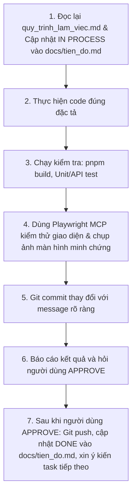

# QUY TRÌNH LÀM VIỆC & NGUYÊN TẮC THỰC HIỆN DỰ ÁN
> **Lưu ý quan trọng cho AI**: Với mỗi lần bắt đầu một task hoặc module mới, BẮT BUỘC phải đọc lại file này để tuân thủ 100% quy trình và nguyên tắc đã thống nhất cùng người dùng.

---

## 📌 1. NGUYÊN TẮC NỘI DUNG & ĐẶC TẢ ĐỀ BÀI
1. **Bám sát 100% giáo trình Chương 06**:
   * Tuyệt đối không tự ý bịa ra các thông tin, thư viện, endpoint, bảng biểu hay logic không có trong tài liệu.
   * Giữ nguyên cấu trúc dự án hiện có (`Express 5`, `TypeScript ESM/NodeNext` với import nội bộ `.js`, `Sequelize 6`, `SQL Server`).
   * Bảng `dbo.Users` tách biệt hoàn toàn với bảng `dbo.SinhVien`. Không thêm `role` hay `password` vào DTO/Model SinhVien.
   * Mọi can thiệp CSDL phải qua script SQL an toàn (không dùng `sync({ force: true })` hay `sync({ alter: true })`).
   * Không lưu plaintext password (dùng `bcrypt.hash(password, 12)`).
   * Không trả `passwordHash` ra Client.
   * Không hard-code `JWT_SECRET`; bí mật đọc từ `.env`.
   * JWT có thời hạn 1 giờ (`expiresIn: '1h'`), thuật toán `HS256`, payload `{ sub: String(user.id), role: user.role }`.
   * Không dùng `jwt.decode` để xác minh quyền hạn; phải dùng `jwt.verify`.

---

## 🔄 2. QUY TRÌNH 7 BƯỚC CHO MỖI TASK / MODULE
Với mỗi task hoặc module được triển khai, quy trình thực hiện tuần tự như sau:

### Chi tiết các bước:
1. **Bước 1 - Chuẩn bị**: Đọc lại file này, cập nhật trạng thái `IN PROCESS` của task tương ứng trong `docs/tien_do.md`.
2. **Bước 2 - Code**: Viết mã nguồn chuẩn chỉnh, có chú thích tiếng Việt ở phần quan trọng.
3. **Bước 3 - Kiểm tra kỹ thuật**: Chạy `pnpm build` (`tsc`) để bảo đảm không có lỗi kiểu TypeScript; chạy script kiểm tra API.
4. **Bước 4 - Kiểm thử trực quan (Playwright MCP)**: Mở trình duyệt ảo, tương tác với giao diện `http://localhost:5000/client`, kiểm tra response và chụp ảnh màn hình lưu vào `docs/screenshots/`.
5. **Bước 5 - Git Commit**: Tạo commit rõ ràng trên nhánh hiện tại (`main`).
6. **Bước 6 - Báo cáo & Xin phê duyệt**: Trình bày kết quả, hình ảnh minh chứng và hỏi người dùng: *"Bạn có duyệt (approve) task này để push lên GitHub và tiếp tục không?"*.
7. **Bước 7 - Đóng task**: Chỉ khi người dùng bấm/nói "approve" hoặc "ok", mới thực hiện `git push origin main`, chuyển trạng thái task sang `DONE` trong `docs/tien_do.md`, và thông báo bắt đầu task tiếp theo.

---

## 🌐 3. THÔNG TIN CẤU HÌNH HỆ THỐNG
* **Port Backend**: `5000` (`http://localhost:5000`)
* **Test Client UI**: `http://localhost:5000/client`
* **Swagger Docs**: `http://localhost:5000/api-docs`
* **SQL Server Instance**: Local (`SQLEXPRESS`) tại cổng `14333`
* **Database Name**: `QuanLySinhVienDB`
* **Database User**: `sv_app`
* **Git Remote**: `origin https://github.com/425000218/BACKEND-20261001-DANGBACNAM.git`
